# Excel 6주차 정규 과제 

📌Excel 정규과제는 매주 정해진 분량의 『*진짜 쓰는 실무 엑셀*』 을 읽고 학습하는 것입니다. 이번주는 아래의 **EXCEL_6th_TIL**에 나열된 분량을 읽고 공부하시면 됩니다.

아래의 문제를 풀어보며 학습 내용을 점검하세요. 문제를 해결하는 과정에서 개념을 스스로 정리하고, 필요한 경우 제시된 강의를 참고하여 보완하는 것이 좋습니다.

**교재 실습 예제 파일은 1주차 과제 설명 노션에 있습니다. 해당 파일을 다운 후 실습 진행해주시면 됩니다.**

**👀(수행 인증샷은 필수입니다.)** 

## EXCEL_6th_TIL

### 7장 엑셀 활용의 10%를 채워 줄 기본 & 필수 함수 익히기
#### 01. 엑셀 기초 계산 함수와 통계 함수 사용하기
#### 02. 논리 함수, 참조 함수, 집계 함수
#### 03. 엑셀의 활용도를 올려 줄 실무 보조 함수
#### 04. 더 강력해진 기능의 엑셀 2021 이후 버전, M365 신규 함수
#### 05. 실무에서 발생하는 어려움을 해결하는 필수 함수 공식

## Study Schedule

| 주차  | 공부 범위     | 완료 여부 |
| ----- | ------------- | --------- |
| 1주차 | p.22~111    | ✅         |
| 2주차 | p.112~157   | ✅         |
| 3주차 | p.158~213  | ✅         |
| 4주차 | p.214~273 | ✅         |
| 5주차 | p.274~339 | ✅         |
| 6주차 | p.340~425 | ✅         |
| 7주차 | p.426~472 | 🍽️         |


<br>

<!-- 여기까진 그대로 둬 주세요-->

---

# 1️⃣ 학습 내용 정리

## 07-1. 엑셀 기초 계산 함수와 통계 함수 사용하기
> **SUM, AVERAGE, COUNTA 함수로 재고 현황 파악하기(342 ~ 344p)를 진행 후 인증사진을 첨부해주세요.**

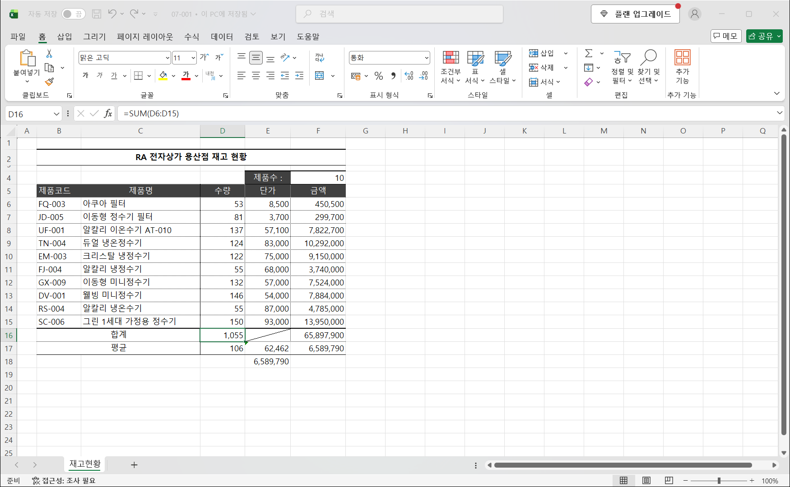

| 셀 | 수식 | 결과 |
| --- | --- | --- |
| F4 (제품수) | `=COUNTA(B6:B15)` | 10 |
| D16 / F16 (합계) | `=SUM(D6:D15)` / `=SUM(F6:F15)` | 1,055 / 65,897,900 |
| D17 / F17 (평균) | `=AVERAGE(D6:D15)` / `=AVERAGE(F6:F15)` | 106 / 6,589,790 |
| E17 (평균 단가) | `=F17/D17` | 62,462 |

- `COUNTA`는 비어 있지 않은 셀을 세므로 텍스트인 제품코드 개수를 셀 때 씁니다. 숫자만 세는 `COUNT`와 구분합니다.
- 단가 평균은 `AVERAGE(E6:E15)`가 아니라 **금액 평균 ÷ 수량 평균**(`=F17/D17`)으로 구해야 수량이 반영됩니다. E18(`=D17*E17`)이 F17과 같은 값이 되는 것으로 검산할 수 있습니다.

> **MAX, MIN, LARGE, SMALL 함수로 만족도 통계 구하기(345 ~ 347p)를 진행 후 인증사진을 첨부해주세요.**

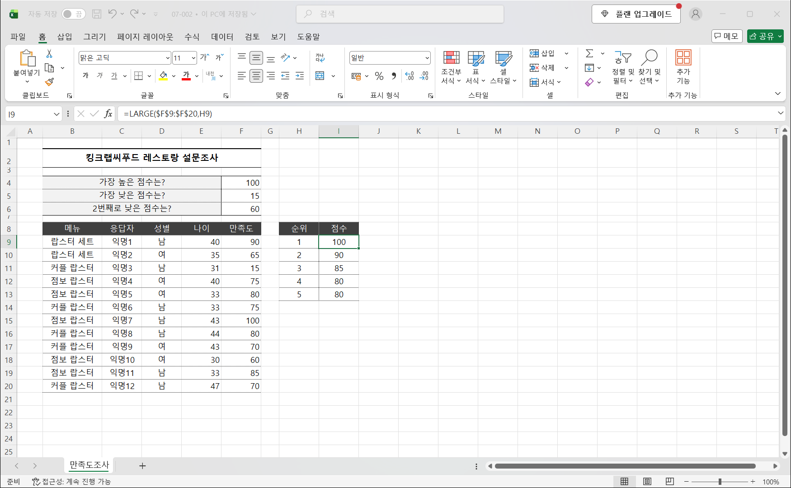

| 셀 | 수식 | 결과 |
| --- | --- | --- |
| F4 가장 높은 점수 | `=MAX(F9:F20)` | 100 |
| F5 가장 낮은 점수 | `=MIN(F9:F20)` | 15 |
| F6 2번째로 낮은 점수 | `=SMALL(F9:F20,2)` | 60 |
| I9:I13 순위별 점수 | `=LARGE($F$9:$F$20,H9)` | 100, 90, 85, 80, 80 |

- `LARGE/SMALL(범위, k)`는 k번째로 큰/작은 값을 돌려줍니다. 범위는 `$`로 고정하고 k는 순위 셀(H9)을 참조해야 아래로 채울 수 있습니다.


## 07-2. 논리 함수, 참조 함수, 집계 함수
> **IF 함수로 성적 관리하기(348 ~ 350p)를 진행 후 인증사진을 첨부해주세요.**

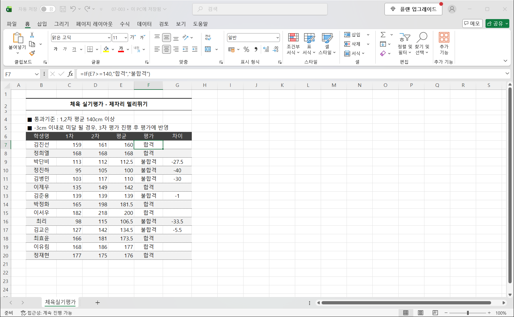

```excel
F7  =IF(E7>=140,"합격","불합격")
G7  =IF(F7="불합격",E7-140,"")
```

- 평균(E열)이 140cm 이상이면 합격입니다. 불합격일 때만 기준과의 차이를 표시하고, 합격이면 빈 문자열 `""`을 돌려줍니다.

> **VLOOKUP, IFERROR 함수로 재고 현황 관리하기(351 ~ 355p)를 진행 후 인증사진을 첨부해주세요.**

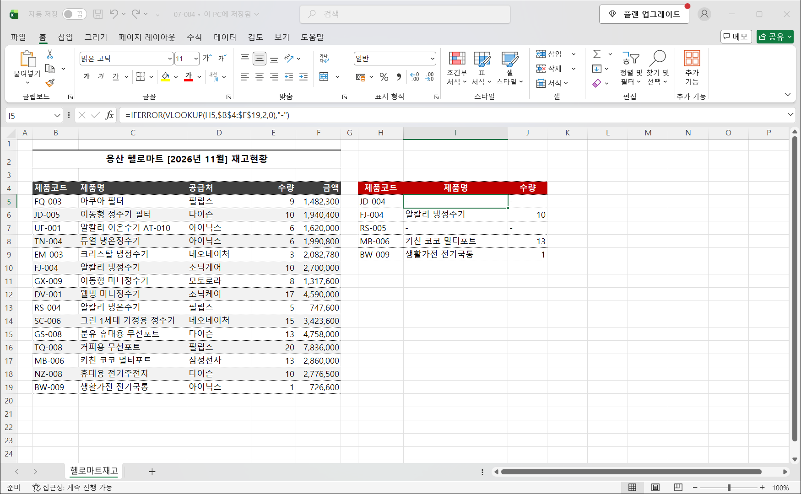

```excel
I5  =IFERROR(VLOOKUP(H5,$B$4:$F$19,2,0),"-")   ' 제품명
J5  =IFERROR(VLOOKUP(H5,$B$4:$F$19,4,0),"-")   ' 수량
```

- 마지막 인수 `0`(FALSE)은 정확히 일치하는 값만 찾습니다.
- 목록에 없는 코드(`JD-004`, `RS-005`)는 원래 `#N/A`가 나지만, `IFERROR`로 감싸서 `-`로 표시합니다.

> **SUMIF, COUNTIF, AVERAGEIF 함수로 매출, 배송 현황 관리(355 ~ 365p)를 진행 후 인증사진을 첨부해주세요.**

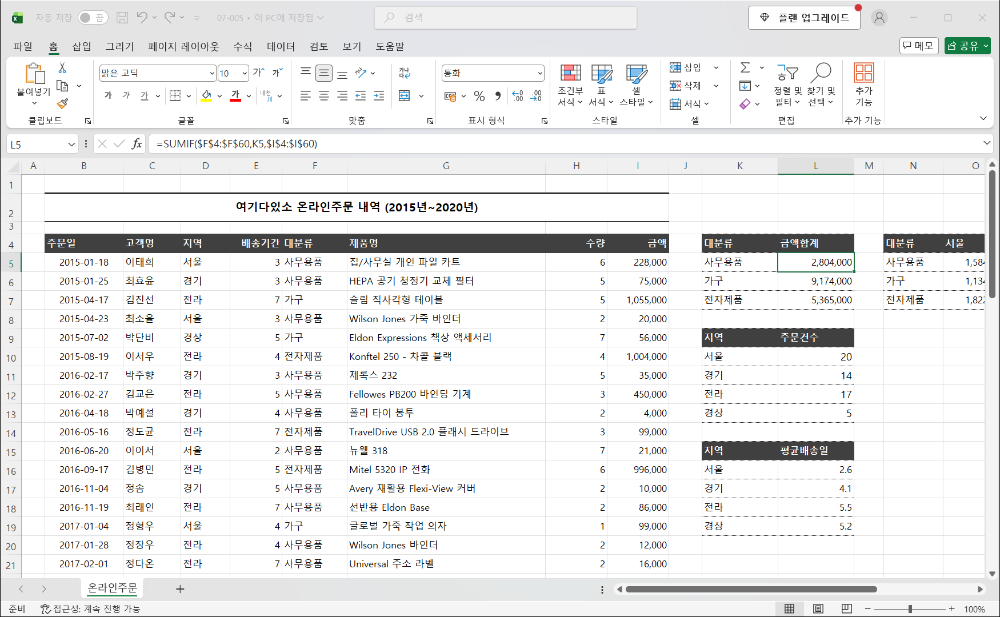

| 셀 | 수식 | 의미 |
| --- | --- | --- |
| L5 | `=SUMIF($F$4:$F$60,K5,$I$4:$I$60)` | 대분류별 금액 합계 |
| L10 | `=COUNTIF($D$4:$D$60,K10)` | 지역별 주문 건수 |
| L16 | `=AVERAGEIF($D$4:$D$60,K16,$E$4:$E$60)` | 지역별 평균 배송일 |
| O5 | `=SUMIFS($I$4:$I$60,$F$4:$F$60,$N5,$D$4:$D$60,O$4)` | 대분류 × 지역 매출 |

- `SUMIF(조건범위, 조건, 합계범위)`와 달리 `SUMIFS`는 **합계범위가 첫 번째 인수**입니다.
- O5의 `$N5`(열 고정)와 `O$4`(행 고정) 혼합 참조 덕분에 수식 하나를 O5:R7 전체에 채울 수 있습니다.


## 07-3. 엑셀의 활용도를 올려 줄 실무 보조 함수
> **LEFT, RIGHT, MID 함수로 텍스트 가공하기(366 ~ 370p)를 진행 후 인증사진을 첨부해주세요.**

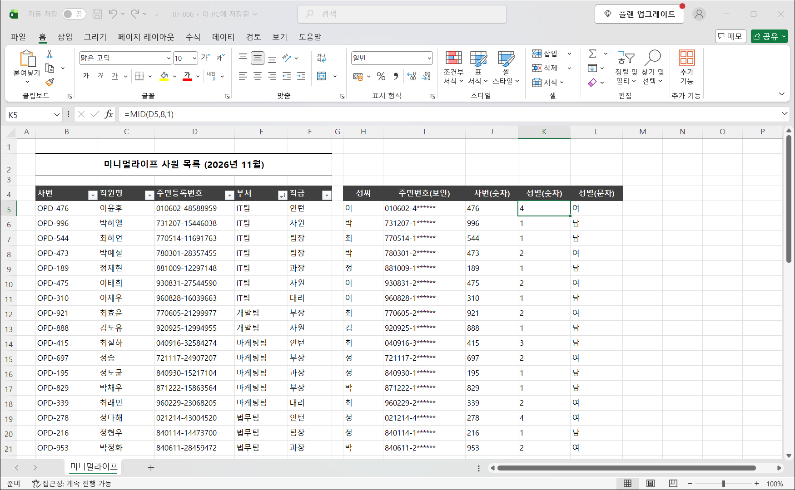

```excel
H5  =LEFT(C5,1)                  ' 성
I5  =LEFT(D5,8)&"******"         ' 주민번호 뒷자리 가리기
J5  =RIGHT(B5,3)                 ' 사번 숫자
K5  =MID(D5,8,1)                 ' 성별 코드(8번째 글자)
L5  =IF(ISODD(K5),"남","여")      ' 홀수면 남, 짝수면 여
```

> **TRIM 함수 사용으로 보이지 않는 문자로 인한 오류 방지하기(370 ~ 373p)를 진행 후 인증사진을 첨부해주세요.**

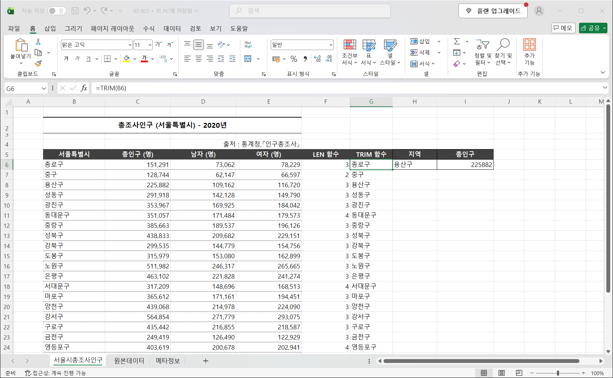

```excel
F6  =LEN(B6)                       ' 앞쪽 공백 때문에 글자 수가 실제보다 많음
G6  =TRIM(B6)                      ' 공백 제거 → "종로구"
I6  =VLOOKUP(H6,$B$5:$E$31,2,0)    ' 정리 후 조회 성공 → 225,882
```

- 통계청에서 받은 데이터는 구 이름 앞에 보이지 않는 공백이 섞여 있어서 `VLOOKUP`이 `#N/A`를 냅니다. TRIM 결과(G열)를 복사해 B열에 **값으로 붙여넣기**하면 조회가 정상 동작합니다.

> **TODAY, DATE, YEAR/MONTH/DATE 함수로 날짜 구하기(381 ~ 383p)를 진행 후 인증사진을 첨부해주세요.**

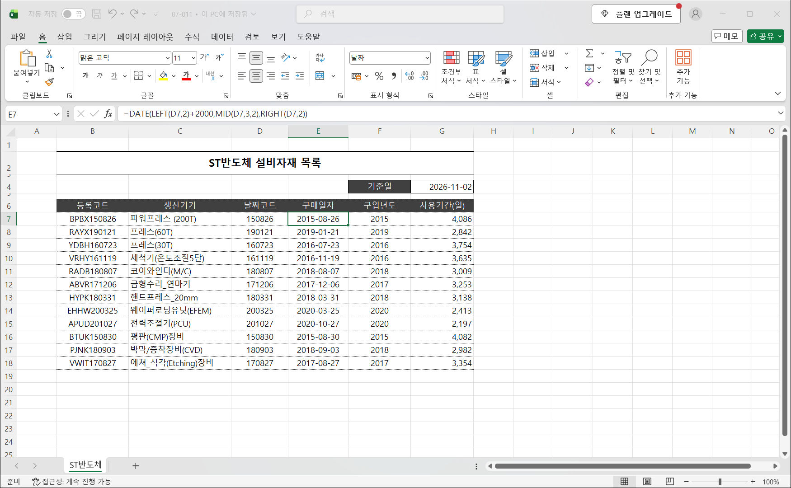

```excel
G4  =TODAY()
D7  =RIGHT(B7,6)                                       ' "150826"
E7  =DATE(LEFT(D7,2)+2000,MID(D7,3,2),RIGHT(D7,2))     ' 2015-08-26
F7  =YEAR(E7)                                          ' 2015
G7  =$G$4-E7                                           ' 사용기간(일)
```

- 자산코드 끝 6자리(yymmdd)를 잘라 `DATE(연,월,일)`로 진짜 날짜 값으로 바꿉니다. 날짜끼리 빼면 일수가 나옵니다.
- G열은 `TODAY()` 기준이라 실습한 날짜에 따라 값이 달라집니다.

> **INDIRECT 함수로 여러 시트 실시간 참조하기(385 ~ 388p)를 진행 후 인증사진을 첨부해주세요.**

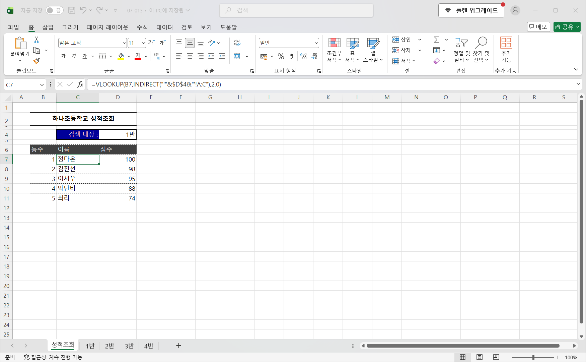

```excel
C7  =VLOOKUP(B7,INDIRECT("'"&$D$4&"'!A:C"),2,0)   ' 이름
D7  =VLOOKUP(B7,INDIRECT("'"&$D$4&"'!A:C"),3,0)   ' 점수
```

- D4에 `1반`~`4반` 중 하나를 고르면 `INDIRECT`가 `'1반'!A:C` 같은 텍스트를 실제 범위로 바꿉니다. 그래서 수식을 고치지 않아도 조회할 시트가 바뀝니다.


## 07-4. 더 강력해진 기능의 엑셀 2021 이후 버전, M365 신규 함수
> **최신 버전 엑셀에서 배열 사용하기(391 ~ 392p)를 진행 후 인증사진을 첨부해주세요.**

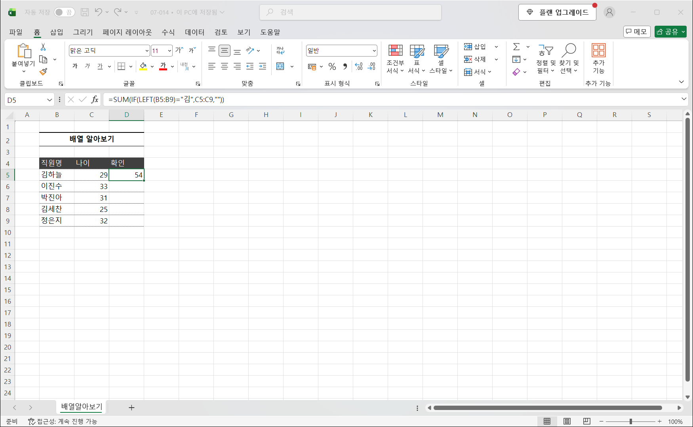

```excel
D5  =B5:B9                                    ' ① 범위가 그대로 분산(Spill)됨
D5  =LEFT(B5:B9)                              ' ② 각 이름의 첫 글자
D5  =IF(LEFT(B5:B9)="김",C5:C9,"")            ' ③ 김씨만 나이 표시
D5  =SUM(IF(LEFT(B5:B9)="김",C5:C9,""))       ' ④ 최종: 김씨 나이 합계 = 54
```

- M365에서는 `Ctrl`+`Shift`+`Enter` 없이 `Enter`만 쳐도 배열 수식이 계산됩니다. 결과가 나올 자리에 값이 있으면 `#SPILL!` 오류가 납니다.

> **VLOOKUP보다 중요한 필수 신규 함수, FILTER(393 ~ 396p)를 진행 후 인증사진을 첨부해주세요.**

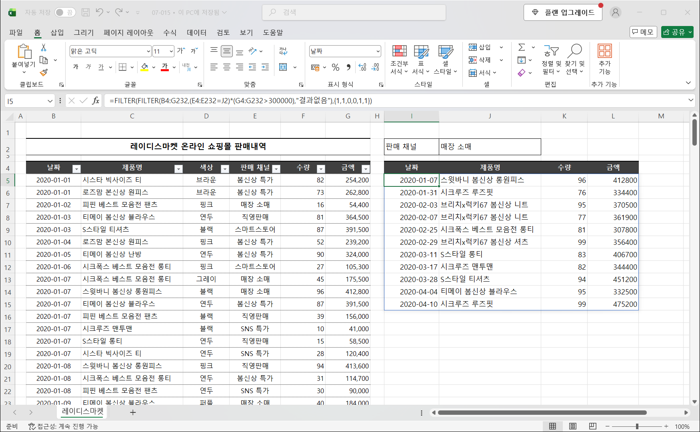

```excel
I5  =FILTER(FILTER(B4:G232,(E4:E232=J2)*(G4:G232>300000),"결과없음"),{1,1,0,0,1,1})
```

- 조건끼리 `*`로 곱하면 AND(판매 채널 = J2 **그리고** 금액 > 300,000)가 됩니다. OR 조건이 필요하면 `+`를 씁니다.
- 바깥 `FILTER`의 `{1,1,0,0,1,1}`은 **열 선택**입니다. 날짜·제품명·수량·금액만 남기고 색상·판매 채널은 뺍니다.

> **이름만으로도 강력해 보이는 M365 신규 함수, XLOOKUP(396 ~ 398p)를 진행 후 인증사진을 첨부해주세요.**

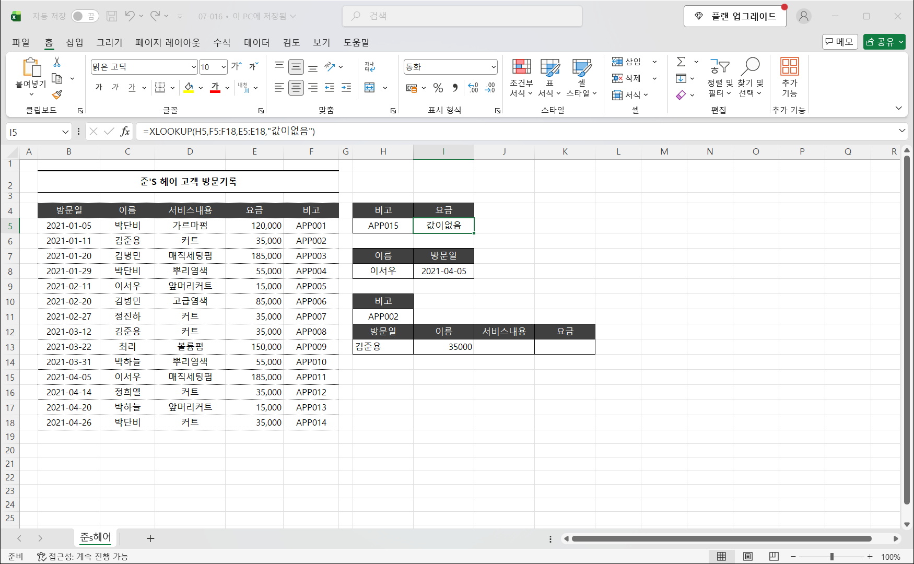

```excel
I5   =XLOOKUP(H5,F5:F18,E5:E18,"값이없음")             ' 없는 값 처리(IFERROR 불필요)
I8   =XLOOKUP(H8,C5:C18,B5:B18,"-",0,-1)               ' 왼쪽 열 조회 + 아래→위 검색(최근 방문일)
H13  =FILTER(XLOOKUP(H11,F5:F18,B5:E18),{0,1,0,1})     ' 여러 열 반환 후 필요한 열만
```

- 검색 범위와 반환 범위를 따로 지정하므로 VLOOKUP과 달리 **왼쪽 열도** 가져올 수 있습니다.
- 6번째 인수 `-1`은 마지막 항목부터 검색합니다. 그래서 `이서우`의 가장 최근 방문일을 찾습니다.

> **다른 기능과 만나면 활용도가 배가 되는 UNIQUE, SORT 함수(399 ~ 402p)를 진행 후 인증사진을 첨부해주세요.**

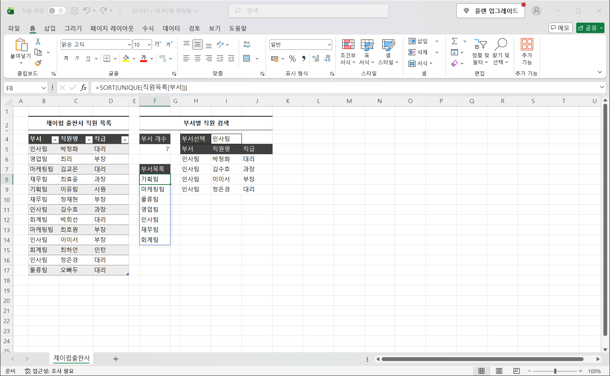

```excel
F8  =SORT(UNIQUE(직원목록[부서]))          ' 중복 없는 부서 목록, 가나다순
F5  =COUNTA(F8#)                           ' 부서 개수 (F8# = 분산 범위 전체)
H6  =FILTER(직원목록[],직원목록[부서]=I4)  ' 선택한 부서 직원 검색
```

- 표(직원목록)와 함께 쓰면 데이터가 추가돼도 부서 목록이 자동으로 늘어납니다. 이 목록(`=$F$8#`)을 I4의 데이터 유효성 검사 목록으로 지정하면 드롭다운이 만들어집니다.


## 07-5. 실무에서 발생하는 어려움을 해결하는 필수 함수 공식
> **여러 조건을 비교해서 결과 출력하기, 다중 조건 IF 함수(403 ~ 407p)를 진행 후 인증사진을 첨부해주세요.**

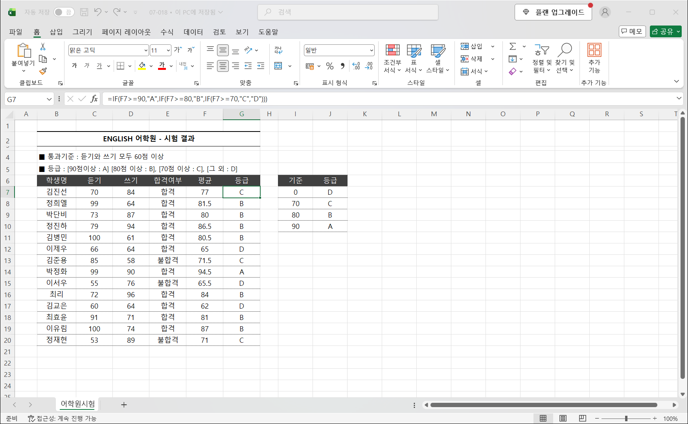

```excel
E7  =IF(AND(C7>=60,D7>=60),"합격","불합격")                  ' 듣기·쓰기 모두 60점 이상
F7  =AVERAGE(C7:D7)
G7  =IF(F7>=90,"A",IF(F7>=80,"B",IF(F7>=70,"C","D")))      ' 중첩 IF로 등급
```

- 중첩 IF는 **큰 기준부터** 비교해야 합니다. 같은 결과를 `=IFS(F7>=90,"A",F7>=80,"B",F7>=70,"C",TRUE,"D")`나 기준표(I:J열)를 쓴 `VLOOKUP(F7,$I$7:$J$10,2,1)`(유사 일치)로도 구할 수 있습니다.

> **단어의 포함 여부를 검색하는 ISNUMBER, SEARCH 함수 공식(407 ~ 411p)를 진행 후 인증사진을 첨부해주세요.**

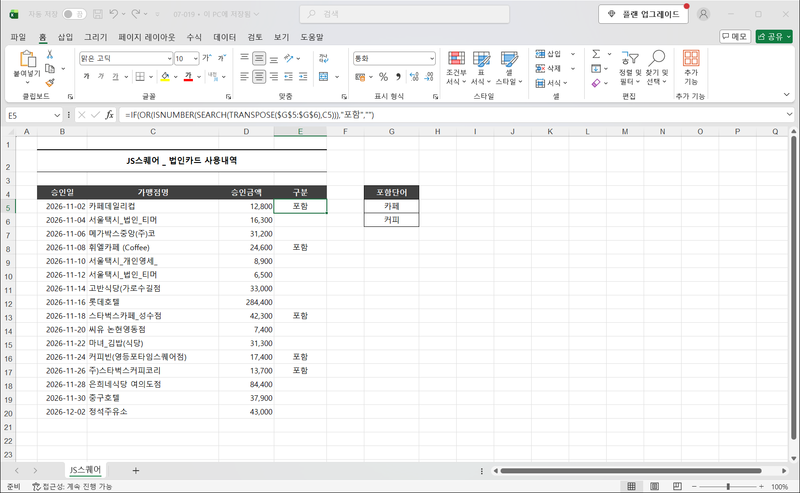

```excel
E5  =IF(OR(ISNUMBER(SEARCH(TRANSPOSE($G$5:$G$6),C5))),"포함","")
```

- `SEARCH`는 단어를 찾으면 위치(숫자)를, 못 찾으면 `#VALUE!`를 돌려줍니다. `ISNUMBER`로 감싸면 TRUE/FALSE가 됩니다.
- 키워드 목록(카페, 커피)을 `TRANSPOSE`로 가로로 바꿔 한 번에 비교하고, `OR`로 하나라도 포함되면 "포함"을 표시합니다.

> **VLOOKUP 함수의 단점을 해결해 주는 INDEX/MATCH 함수 공식(412 ~ 415p)를 진행 후 인증사진을 첨부해주세요.**

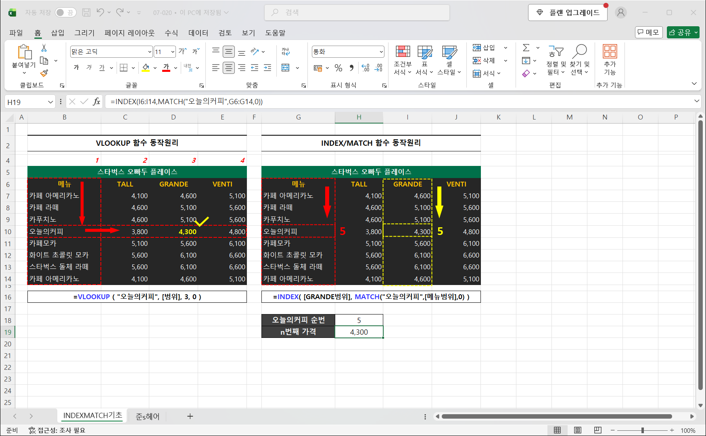

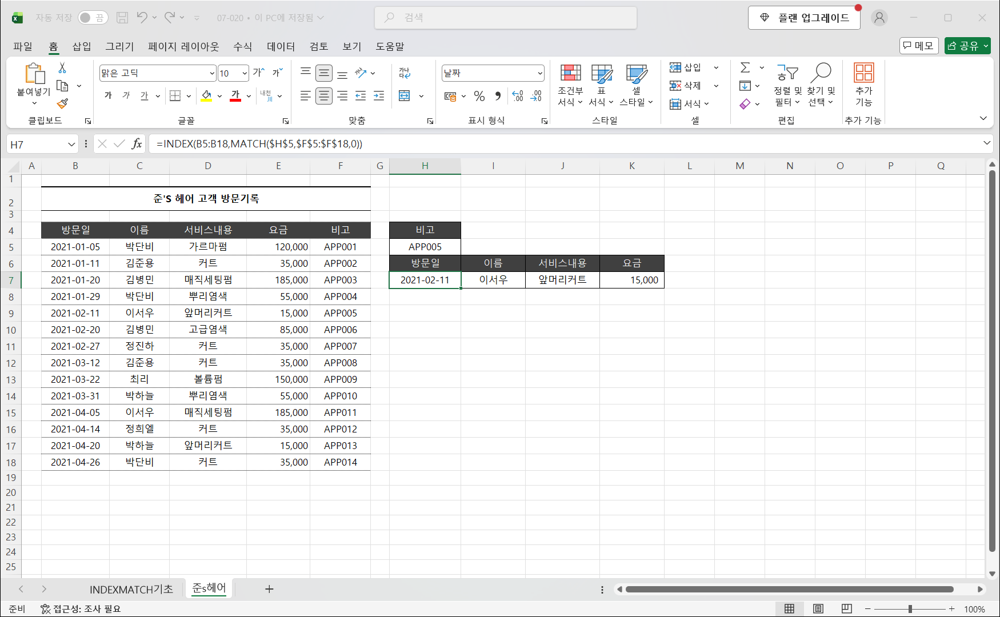

```excel
H18  =MATCH("오늘의커피",G6:G14,0)                  ' 5 (몇 번째 행인지)
H19  =INDEX(I6:I14,MATCH("오늘의커피",G6:G14,0))    ' 4,300 (GRANDE 가격)
H7   =INDEX(B5:B18,MATCH($H$5,$F$5:$F$18,0))        ' 비고 APP005 → 방문일 (왼쪽 열 조회)
```

- `MATCH`로 위치를 찾고 `INDEX`로 그 위치의 값을 가져옵니다. 열 번호를 숫자로 적지 않아서 열을 넣거나 빼도 결과가 틀어지지 않고, 왼쪽 방향 조회도 됩니다.

> **여러 조건을 만족하는 결과 겁색하기, VLOOKUP 다중 조건 공식(415 ~ 417p)를 진행 후 인증사진을 첨부해주세요.**

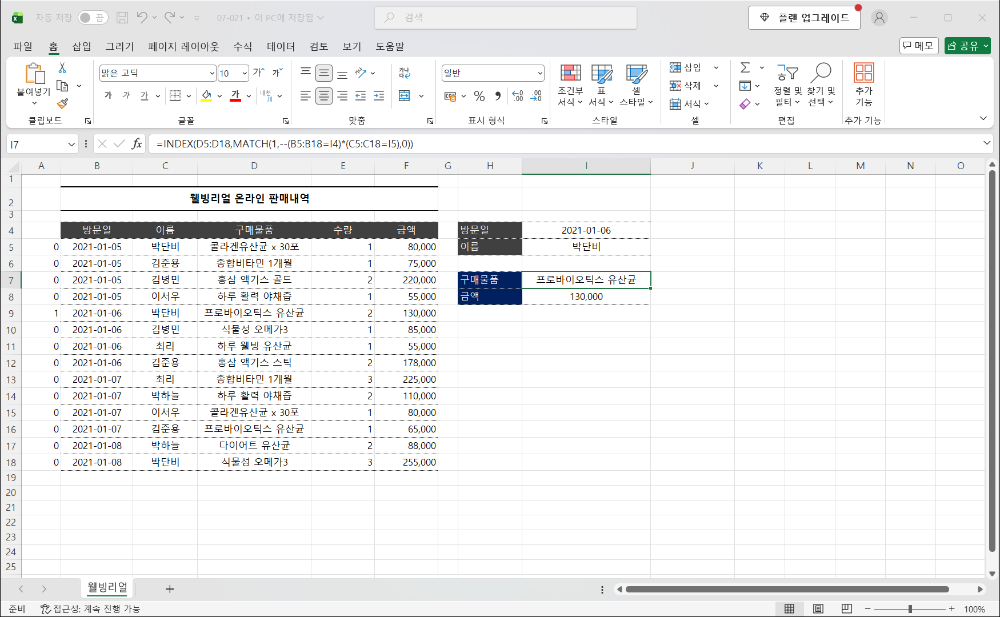

```excel
A5  =--(B5:B18=I4)*(C5:C18=I5)                                  ' 조건 확인용: 두 조건을 모두 만족하는 행만 1
I7  =INDEX(D5:D18,MATCH(1,--(B5:B18=I4)*(C5:C18=I5),0))         ' 구매물품
I8  =INDEX(F5:F18,MATCH(1,--(B5:B18=I4)*(C5:C18=I5),0))         ' 금액
```

- 방문일 = `2021-01-06` **그리고** 이름 = `박단비`인 행을 찾습니다. 조건 배열을 곱하면 두 조건을 모두 만족하는 행만 1이 되고, `MATCH(1, …, 0)`이 그 위치를 찾습니다.
- 결과: 프로바이오틱스 유산균 / 130,000원


---


### 🎉 수고하셨습니다.
