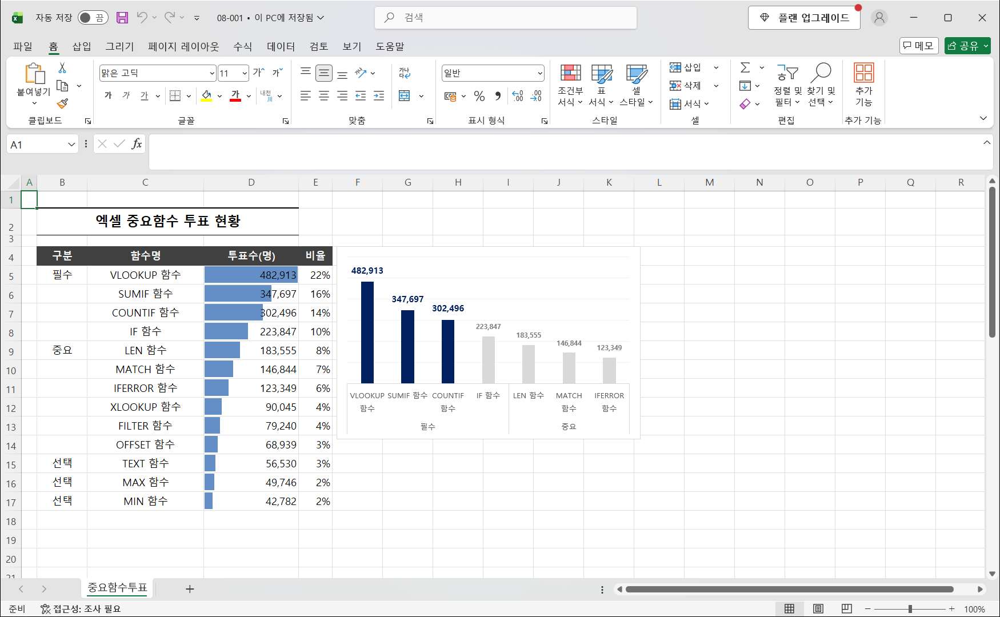
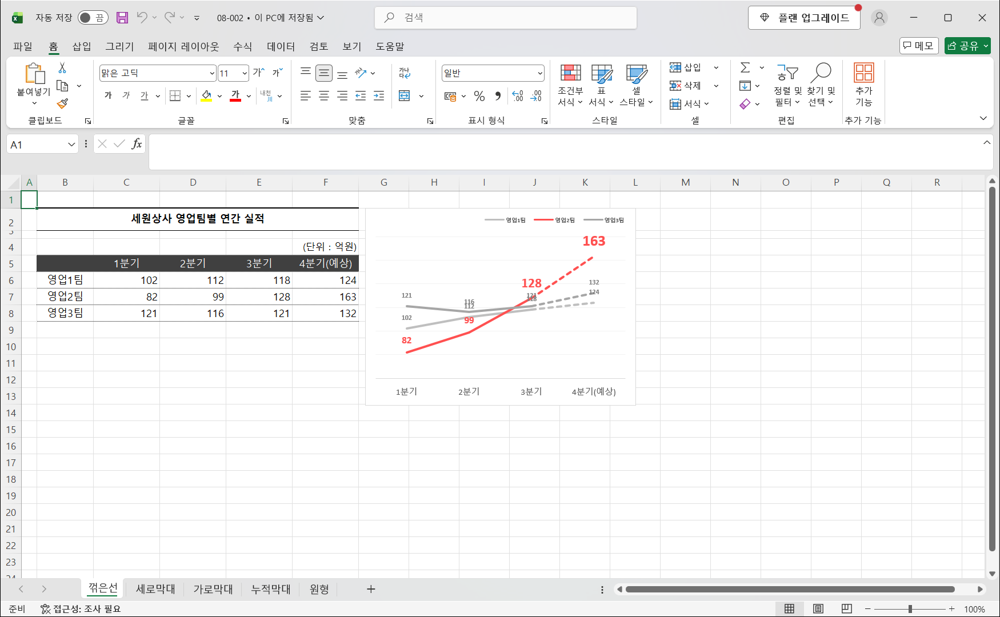
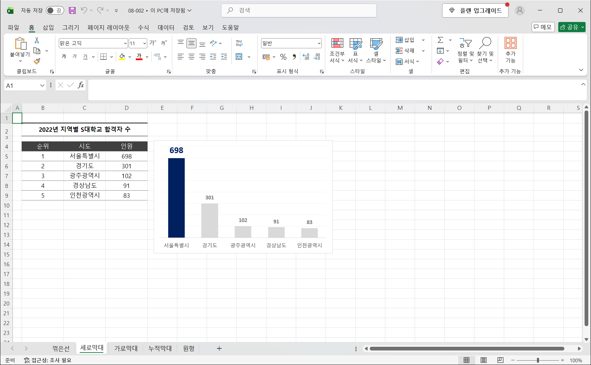
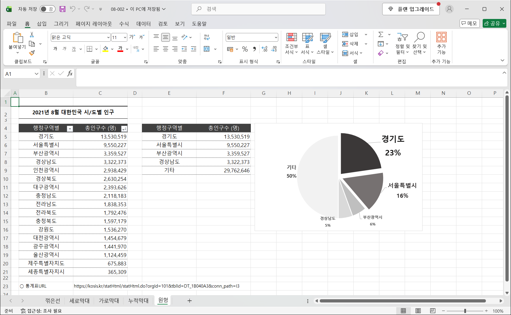
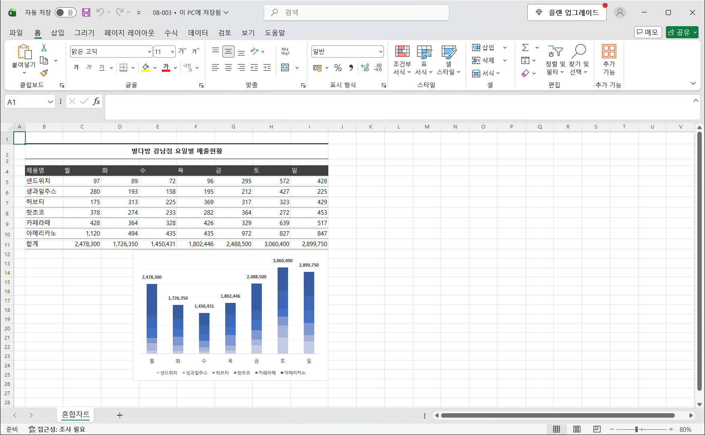
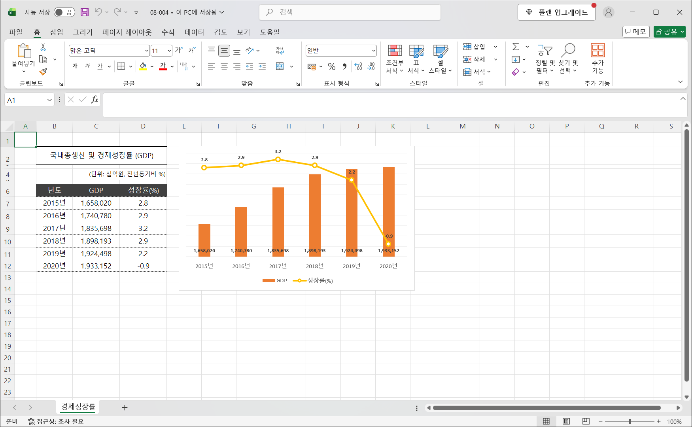

# Excel 7주차 정규 과제 

📌Excel 정규과제는 매주 정해진 분량의 『*진짜 쓰는 실무 엑셀*』 을 읽고 학습하는 것입니다. 이번주는 아래의 **EXCEL_7th_TIL**에 나열된 분량을 읽고 공부하시면 됩니다.

아래의 문제를 풀어보며 학습 내용을 점검하세요. 문제를 해결하는 과정에서 개념을 스스로 정리하고, 필요한 경우 제시된 강의를 참고하여 보완하는 것이 좋습니다.

**교재 실습 예제 파일은 1주차 과제 설명 노션에 있습니다. 해당 파일을 다운 후 실습 진행해주시면 됩니다.**

**👀(수행 인증샷은 필수입니다.)** 

## EXCEL_7th_TIL

### 8장 실무에서 필요한 엑셀 데이터 시각화의 모든 것
#### 01. 시각화 차트를 잘 만들기 위한 3가지 규칙 (범위 제외)
#### 02. 실무에서 사용하는 엑셀 차트 기본 공식
#### 03. 직장인이라면 반드시 기억해야 할 실무 차트 5가지
#### 04. 기본 차트를 응용한 혼합 차트와 간트 차트 만들기

## Study Schedule

| 주차  | 공부 범위     | 완료 여부 |
| ----- | ------------- | --------- |
| 1주차 | p.22~111    | ✅         |
| 2주차 | p.112~157   | ✅         |
| 3주차 | p.158~213  | ✅         |
| 4주차 | p.214~273 | ✅         |
| 5주차 | p.274~339 | ✅         |
| 6주차 | p.340~425 | ✅         |
| 7주차 | p.426~472 | ✅         |

 

<!-- 여기까진 그대로 둬 주세요-->

---

# 1️⃣ 학습 내용 정리

## 08-2. 실무에서 사용하는 엑셀 차트 기본 공식
> **5단계 과정에 따라 차트 완성하기(435 ~ 444p)를 진행 후 인증사진을 첨부해주세요.**

- 차트는 **① 주제 정하기 → ② 차트 종류 결정 → ③ 색감·스타일 등 테마 정하기 → ④ 차트 간소화하기 → ⑤ 차트 꾸미기** 순서로 만듭니다.
- ① 주제 정하기: 투표수에 데이터 막대를 넣어 보니 상위 몇 개 항목의 비중이 컸습니다. `=D5/SUM($D$5:$D$17)`로 비율을 구했고, 상위 3개 함수의 합계가 52%였습니다. 그래서 차트의 주제를 "엑셀 중요 함수 상위 3개 비중이 50%를 넘는다"로 정했습니다.
- ② 차트 종류: 항목별 값의 크기를 비교하므로 세로 막대형 차트를 골랐습니다.
- ④ 차트 간소화: 항목이 많으면 메시지가 흐려지므로 상위 7개만 표시했습니다. 차트 제목, 세로 축처럼 불필요한 요소는 지우고, 데이터 레이블로 값을 바로 보여 줍니다.
- ⑤ 차트 꾸미기: 강조할 상위 3개 막대만 진한 색으로, 나머지는 연한 회색으로 바꿔 핵심 메시지가 한눈에 보이게 했습니다.

## 08-3. 직장인이라면 반드시 기억해야 할 실무 차트 5가지
> **시간의 흐름, 미래 데이터 예측은 꺾은선형 차트(445 ~ 449p)를 진행 후 인증사진을 첨부해주세요.**

- 꺾은선형 차트는 분기별 실적처럼 **시간에 따른 변화**를 보여 줄 때 씁니다.
- 세로 축 최솟값이 0이면 선이 위쪽에 몰려 변화가 잘 보이지 않습니다. 그래서 [축 서식]에서 최솟값을 **60**으로 바꿔 차이가 드러나게 했습니다.
- 4분기는 예상치이므로 3분기 → 4분기 구간을 **점선**으로 바꿔 실적과 예측을 구분했습니다. 강조할 영업2팀만 빨간색으로 표시하고, 나머지 팀은 회색으로 두었습니다.

> **항목별 값의 차이 파악은 세로 막대형 차트(450 ~ 452p)를 진행 후 인증사진을 첨부해주세요.**

- 세로 막대형 차트는 **항목별 값의 크기 차이**를 비교할 때 씁니다. 항목이 많지 않을 때(5개 안팎) 알맞습니다.
- 서울특별시만 진한 색으로, 나머지 지역은 회색으로 바꿨습니다. 그래서 1위와 나머지 지역의 차이가 바로 보입니다.
- 세로 축을 지우고 데이터 레이블로 값을 표시해 차트를 간결하게 만들었습니다.

> **특정 항목의 점유율을 강조할 때는 원형 차트(459 ~ 461p)를 진행 후 인증사진을 첨부해주세요.**

- 원형 차트는 **전체 대비 특정 항목의 점유율**을 강조할 때 씁니다. 조각이 많으면 읽기 어려우므로 5개 안팎으로 줄입니다.
- 상위 4개 시/도는 원본을 참조하고(`=C5`), 나머지는 `기타`로 묶어 합계를 구한 보조 표(E:F열)를 만든 뒤 그 범위로 차트를 그렸습니다.
- 강조할 경기도·서울특별시 조각만 진한 색으로 표시했고, 데이터 레이블에 항목 이름과 백분율을 함께 넣었습니다.

## 08-4. 기본 차트를 응용한 혼합 차트와 간트 차트 만들기
> **혼합 차트 기능으로 누적 세로 막대형에 합계 레이블 표시하기(462 ~ 466p)를 진행 후 인증사진을 첨부해주세요.**

- 누적 세로 막대형 차트에는 막대 전체의 합계가 따로 표시되지 않습니다. 그래서 **합계 행(11행)까지 포함해 차트를 만든 뒤**, [차트 종류 변경]에서 `합계` 계열만 **꺾은선형**으로 바꾸는 혼합 차트를 만들었습니다.
- 합계 꺾은선에 데이터 레이블을 **위쪽**으로 표시한 뒤 선을 `선 없음`으로 바꿨습니다. 그러면 선은 보이지 않고 막대 위에 합계 값만 남습니다.
- 범례에서 `합계` 항목은 지워서 제품별 계열만 남겼습니다.

> **단위가 서로 다른 값을 표현할 때 혼합 차트의 보조 축 사용하기(467 ~ 471p)를 진행 후 인증사진을 첨부해주세요.**

- GDP(십억 원)와 성장률(%)은 단위와 크기가 크게 달라서, 한 축에 그리면 성장률이 바닥에 붙어 보이지 않습니다.
- [차트 종류 변경] - [혼합]에서 GDP는 **묶은 세로 막대형**, 성장률은 **표식이 있는 꺾은선형**으로 지정하고, 성장률에 **보조 축**을 체크했습니다.
- 왼쪽 기본 축은 GDP, 오른쪽 보조 축은 성장률을 나타냅니다. 그래서 두 값의 추이를 한 차트에서 함께 비교할 수 있습니다.

---

한 학기 동안 다소 부족한 커리큘럼이었음에도 불구하고 성실하게, 그리고 열심히 과제를 수행해주셔서 진심으로 감사드립니다.

이번 과정을 통해 배운 내용이 앞으로 여러분이 엑셀을 다루는 데에 조금이나마 도움이 되기를 바랍니다.

여러분의 앞날을 진심으로 응원합니다. 😊

### 🎉 수고하셨습니다.
